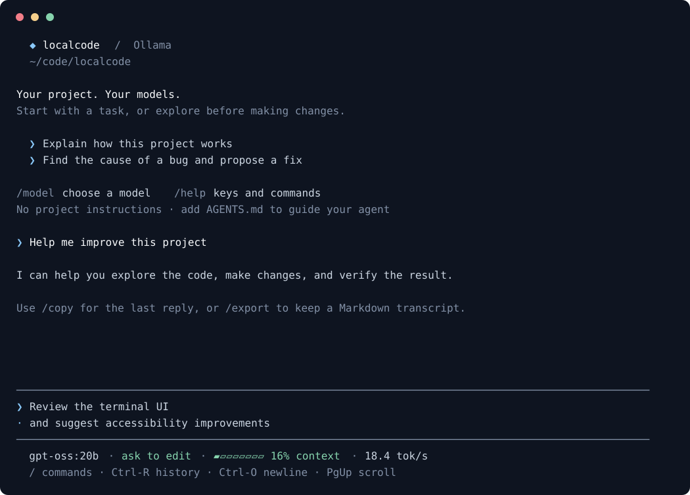

# localcode

A terminal coding agent built around local [Ollama](https://ollama.com) models. One Python file, standard library only.



*Sample conversation rendered from the interface. Colors and fonts follow your terminal's settings.*

## Install

Needs Python 3.9+ and [Ollama](https://ollama.com).

```bash
git clone https://github.com/EthanWellsSr/localcode.git
cd localcode
pip3 install -e .
```

That adds a `localcode` command you can run from any folder. `-e` keeps it pointed at the clone, so `git pull` updates it with no reinstall. To remove it: `pip3 uninstall localcode`.

If your shell can't find `localcode` after installing, pip's script folder isn't on your PATH; `python3 -m pip show -f localcode` shows where it went.

## Run

```bash
ollama serve                     # if Ollama isn't already running
localcode                        # interactive, works in the current directory
localcode -C ~/code/myproject
localcode "fix the failing tests"   # one-shot
localcode -m qwen3-coder:30b        # pick a model
localcode --plain                 # inline prompts and native terminal scrollback
localcode --version
```

## Tools the model gets

`read_file`, `read_files` (several files in one call), `write_file`, `edit_file`, `list_dir`, `glob`, `grep`, `bash`, `web_fetch`.

`web_fetch` loads an http or https page and gives the model its readable text: scripts, styles and menus are dropped, and only the page's main content is kept when it marks one. Headings, lists, links and code blocks come through as Markdown. JSON and plain text pass through unchanged, and long pages come in parts. It only fetches pages; it can't search the web. On macOS it uses the system's root certificates if your Python install doesn't have its own.

Long files are returned in pages with the exact `offset` to read next. Re-reading the same lines of an unchanged file gets a short "you already have this" reply instead of the full text again. Asking for more lines, or reading again after a failed edit, returns the text.

Writes, edits, shell commands and web fetches show a diff, the command or the URL and ask before running: `[Y]es / [n]o / [a]lways for this tool`. Enter accepts; `a` remembers that tool for the current session. The status line shows the approval mode; `/status` also lists tools you've allowed for the session.

Auto mode (`--auto`, or `/auto` during a session) approves for you when an action is clearly safe and still asks about the rest. It approves writes and edits inside the project (but not in `.git`), web fetches, and commands that only read (`ls`, `cat`, `grep`, `find`, …), git queries (`status`, `diff`, `log`, `show`, …), `git add`, `git commit` with a message, and test or build runs (`pytest`, `npm test`, `cargo test`, `go test`, `make test`, …), chained with `&&`, `||`, `;` or `|`. A plain `git push` (optionally `-u origin <branch>`) is approved only when your own latest message asks to push, such as "commit and push"; the model deciding to push by itself still asks. It still asks about anything that names a path outside the project, uses redirects, `$` variables or command substitution, force-pushes, deletes branches or tags, amends commits, deletes files, installs, or runs other scripts. Test runs execute your project's code, so turn auto mode on only for projects you trust.

`--yolo` (or `/yolo`) approves everything, including risky commands.

Plan mode (`/plan`) is for when you want to hear the model's plan before anything changes. While it's on, the model can read files, search, fetch pages and run read-only commands, and it's told to reply with what it understood and what it would do. Writes, edits, installs, test runs, git changes and other commands are refused, whatever the approval mode. The status line shows when it's on; `/plan` again lets the model make changes. Smaller models don't always follow "confirm before you act" in a message, so use plan mode when it matters.

## Output

localcode runs full-window on the terminal's alternate screen, like `vim` or `htop`: your earlier terminal output is out of view while it runs and comes back unchanged when you quit. A compact header shows the workspace, leaving room for the conversation. The input stays pinned at the bottom, above the model, approval mode, context usage, and last reply's speed. A context meter appears in wider windows; narrow windows use a percentage.

The welcome screen shows the version and tells you whether project instructions were loaded. Try `/status` for the full session details, including your Ollama address. It doesn't call the model or consume context.

Scroll back through the conversation with the mouse wheel, PgUp/PgDn or Shift+↑/↓, including while the model is thinking or streaming and while an approval prompt waits, so you can read a long diff before answering. Output is kept while you scroll; scroll down or press PgDn to return to the newest output. Other keys typed while the model is working are ignored, so wait for the prompt before typing your next message. Because the mouse wheel is handled by localcode, selecting text with the mouse needs your terminal's override key held while dragging (Fn in Terminal.app, Option in iTerm2). Use `--plain` if you prefer native terminal scrolling, selection, or a simpler display. `NO_COLOR=1` also uses inline prompts without color. Piped output stays plain Markdown.

Reasoning models' thinking is collapsed to a single "✻ Thought for Ns" line (set `LOCALCODE_SHOW_THINKING=1` to see it).

An example of the layout (colors omitted):

```text
  ◆ localcode v0.6.5  /  Ollama
  ~/code/myproject

Your project. Your models.  localcode v0.6.5
Start with a task, or explore before making changes.

/model choose a model   /help keys and commands
────────────────────────────────────────────────────────────────────────────────
❯ Ask about this project…  / commands
────────────────────────────────────────────────────────────────────────────────
  gpt-oss:20b · ask to edit · ▱▱▱▱▱▱▱▱ 0% context
  / commands · Ctrl-R history · Shift-Enter newline
```

Replies are rendered as Markdown while they stream: headings and **bold** in bold, `code` in color, bullets as •, code blocks with a side bar, and tables drawn as aligned boxes that fit the terminal width. When output is piped instead of shown in a terminal, the raw Markdown is passed through.

## Commands and keys

Type `/` and a menu of commands appears under the input: ↑/↓ to choose, Tab to complete, Enter to run, Esc to close. Search by name or description: `/clipboard` finds `/copy`. The menu scrolls as you move through its results. After `/model ` it searches your installed models.

The model picker is searchable too: type part of a name, parameter size, or `native tools` / `text fallback`. ↑/↓ moves through results, PgUp/PgDn moves a page, Enter chooses, and Esc cancels. It keeps the current model selected when first opened and adapts to your window size.

| Command | |
| --- | --- |
| `/model` | Open the model picker, or `/model <name>` to switch straight to one |
| `/status` | Show the model, Ollama address, workspace, instructions, context, and approvals |
| `/history` | Search saved prompts; in full-screen mode, the selected prompt returns to editing without being sent |
| `/copy` | Copy the last assistant reply to the clipboard (`pbcopy` on macOS) |
| `/export [path]` | Save a Markdown conversation; defaults to a timestamped file in the workspace and refuses to overwrite files |
| `/clear` | Start a fresh conversation (re-reads `AGENTS.md`) |
| `/plan` | Toggle plan mode: the model can only read and search, and replies with a plan |
| `/auto` | Toggle auto mode: approve safe edits, commands and fetches, ask about the rest |
| `/yolo` | Toggle auto-approve for everything, including risky commands |
| `/help` | Show commands and keys |
| `/exit` | Quit |

Enter `!<command>` to run a shell command in the project directory. The command, output, and exit status appear in the chat and are included in the model's context. Output is capped at 24,000 characters and commands stop after 60 seconds.

| Key | |
| --- | --- |
| Mouse wheel, PgUp/PgDn, Shift+↑/↓ | Scroll back through the conversation |
| ↑/↓ | Step through past entries (saved across sessions in `~/.config/localcode/history.jsonl`) |
| Ctrl-R | Search prompt history and return a selection to the editor without sending it |
| Shift+Enter | Insert a newline; Enter sends. Long lines wrap below automatically; the composer grows to five rows, then scrolls vertically |
| ↑/↓ in a multiline draft | Move between lines; Ctrl-A / Ctrl-E moves to the start/end of the current line |
| `\` then Enter | Start a new line; pasting multi-line text also works |
| Ctrl-C | Clear the line; on an empty line, quit |
| Ctrl-D | Quit on an empty line; otherwise delete the next character |
| Ctrl-A / Ctrl-E, Ctrl-U / Ctrl-K, Ctrl-W | Start/end of line, delete to start/end, delete word |

The model you pick is remembered for next time (in `~/.config/localcode/state.json`); switching keeps the conversation.

## Keep useful work

Shift+Enter uses the terminal’s [extended keyboard protocol](https://sw.kovidgoyal.net/kitty/keyboard-protocol/). If your terminal sends the same code for Enter and Shift+Enter, configure Shift+Enter to send `\x1b[13;2u` (hex `1b 5b 31 33 3b 32 75`) or LF (`0a`). Backslash followed by Enter also inserts a newline.

Use Ctrl-R to find a previous prompt by a few words. Select it, revise it in the composer, then press Enter when ready. Cancelling keeps your current draft. In `--plain` mode, `/history` offers numbered selection and prints the chosen prompt for copying; readline also provides your shell's usual history search.

After a useful reply, `/copy` puts its original Markdown on the Mac clipboard, including code fences. On Linux it tries `wl-copy`, `xclip`, or `xsel` if installed. If the terminal has no clipboard access, it points you to `/export`.

Use `/export notes.md` to keep the conversation in your project, or `/export` for a timestamped filename. Export includes user messages and assistant replies without internal instructions, tool-call payloads, or file contents returned by tools. It creates a new file and never overwrites one. These commands do not make model requests or change the current context.

## Settings

| Env var | Default |
| --- | --- |
| `LOCALCODE_MODEL` | the last model you picked, else `gpt-oss:20b` |
| `LOCALCODE_NUM_CTX` | `32768` |
| `OLLAMA_HOST` | `http://localhost:11434` |
| `LOCALCODE_SHOW_THINKING` | off; `1` prints reasoning models' thinking in full |

On startup, localcode looks for `AGENTS.md` (any capitalization) in the project and quietly adds it to the system prompt. A line under the banner says whether it was found and ingested.

## Model notes

Some models print tool calls as text instead of returning them as structured calls (qwen2.5-coder writes bare JSON; qwen3-coder writes `<function=...>` XML). localcode parses both formats.

The default is `gpt-oss:20b` (`ollama pull gpt-oss:20b`). It's a mixture-of-experts model that uses about 3.6B parameters per token, so on a 24 GB M-series MacBook Air it runs fully on the GPU at a 32k context (12 GB) and generates at about 18 tok/s, roughly twice as fast as the dense `qwen2.5-coder:14b`. `qwen3-coder:30b` doesn't fully fit on the GPU on that machine and runs slowly.

## Development

No runtime dependencies are needed. Run the regression suite with:

```bash
python3 -m unittest discover -s tests -v
```

The suite uses simulated Ollama responses and a real POSIX pseudo-terminal to check commands, pasted multi-line Unicode text, scrollback, resizing, and terminal restoration. It runs without Ollama or downloaded models. Live model performance and macOS terminal appearance should still be checked on your Mac.
